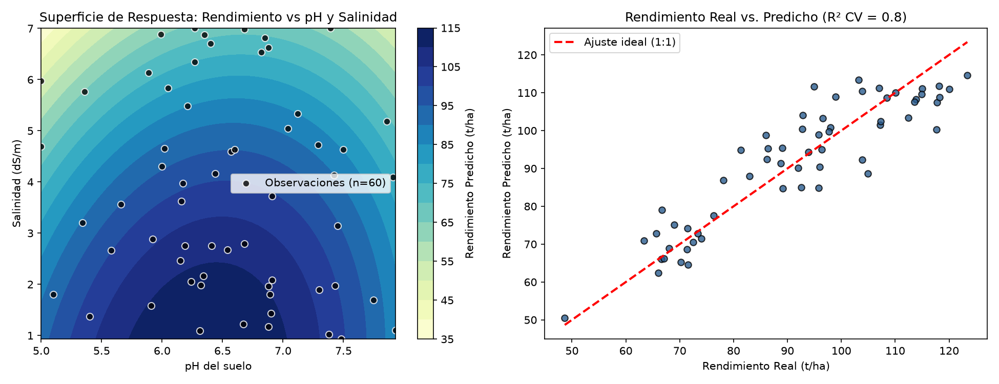

# Predicción de Rendimiento en Tomate (*Solanum lycopersicum*) bajo Estrés Salino y Variaciones de pH

Modelo de aprendizaje automático en Python para predecir el rendimiento comercial (`t/ha`) del cultivo de tomate a partir de parámetros químicos del suelo (`pH` y `Salinidad`), evaluando el impacto del estrés osmótico y la acidez/alcalinidad en la respuesta productiva.

# Descripción del Dataset
El conjunto de datos (`Datos_Agronomicos_Tomate.xlsx`) contiene **60 observaciones** con 4 variables agronómicas:
* **Variables predictoras ($X$):** `pH` del suelo (rango óptimo ~6.0–6.8) y `Salinidad` medida como conductividad eléctrica (`dS/m`, umbral crítico ~2.5 dS/m).
* **Variable objetivo ($Y$):** `Rendimiento` comercial de fruto fresco (`t/ha`).
* **Variable complementaria:** `Biomasa` aérea seca (`g/planta`), excluida como entrada directa en la predicción pre-cosecha para evitar fuga de datos (*data leakage*).

# Comparación de Modelos (Validación Cruzada 5-Fold)
Se evaluaron tres enfoques de regresión mediante validación cruzada (`KFold = 5`):

| Modelo | $R^2$ Promedio | RMSE (t/ha) | MAE (t/ha) |
| :--- | :---: | :---: | :---: |
| Regresión Lineal Múltiple | 0.599 | 11.25 | 8.84 |
| **Regresión Polinómica (Grado 2)** | **0.800** | **7.99** | **6.69** |
| Random Forest Regressor | 0.666 | 10.36 | 8.13 |

La **Regresión Polinómica de Grado 2** obtuvo el mejor desempeño ($R^2 = 0.80$) al capturar adecuadamente la curva óptima cuadrática del pH y la caída progresiva del rendimiento por salinidad:

$$\text{Rendimiento (t/ha)} = -348.67 + 146.77(\text{pH}) - 7.44(\text{CE}) - 11.59(\text{pH}^2) + 1.16(\text{pH} \cdot \text{CE}) - 0.98(\text{CE}^2)$$

# Superficie de Respuesta


# Requisitos y Ejecución
1. Clonar el repositorio y asegurarse de tener los archivos en la misma carpeta:
   * `modelo_rendimiento_tomate.py`
   * `Datos_Agronomicos_Tomate.xlsx`
2. Instalar dependencias:
   ```bash
   pip install pandas numpy scikit-learn matplotlib openpyxl
python modelo_rendimiento_tomate.py
