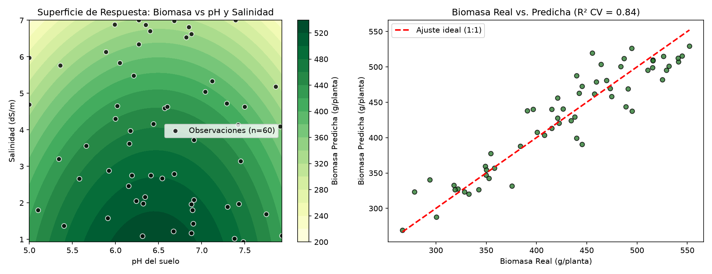

# Modelo 2: Predicción de Biomasa Aérea (`g/planta`)
De forma independiente, se modeló la acumulación de biomasa aérea seca por planta a partir de las mismas condiciones edáficas (`pH` y `Salinidad`), evitando cualquier fuga de datos entre variables de cosecha:

| Modelo | $R^2$ Promedio | RMSE (g/planta) | MAE (g/planta) |
| :--- | :---: | :---: | :---: |
| Regresión Lineal Múltiple | 0.654 | 43.83 | 34.85 |
| **Regresión Polinómica (Grado 2)** | **0.840** | **30.15** | **24.52** |
| Random Forest Regressor | 0.750 | 37.34 | 29.57 |

La **Regresión Polinómica de Grado 2** alcanzó el mayor poder predictivo ($R^2 = 0.84$), reflejando el impacto directo del estrés osmótico y la disponibilidad de nutrientes en el crecimiento vegetativo:

$$\text{Biomasa (g/planta)} = -1505.21 + 636.38(\text{pH}) - 12.54(\text{CE}) - 49.50(\text{pH}^2) + 1.17(\text{pH} \cdot \text{CE}) - 3.65(\text{CE}^2)$$

# Superficie de Respuesta (Biomasa)

